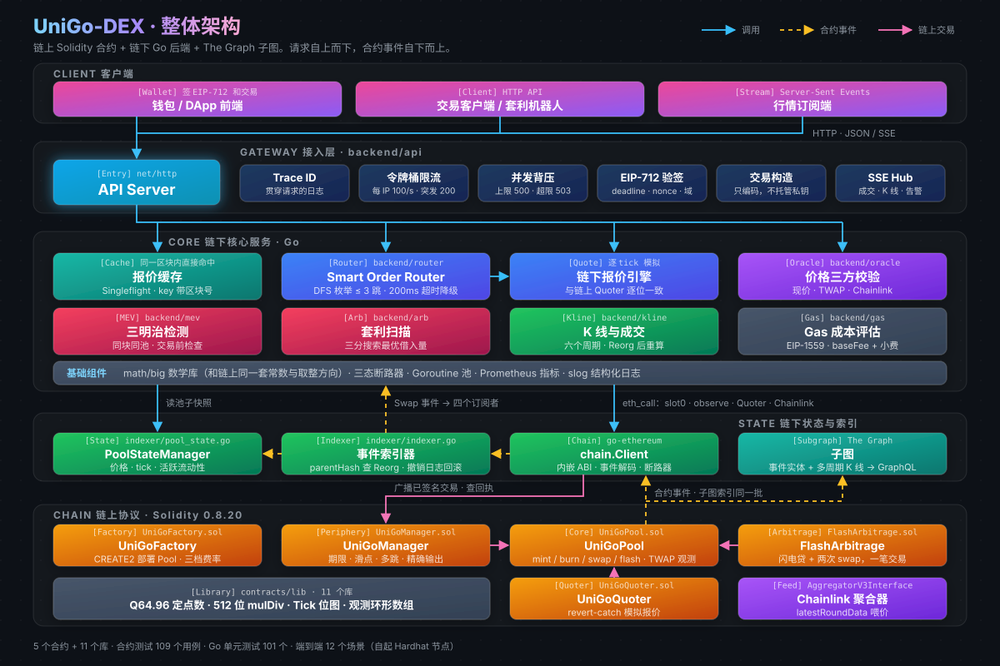
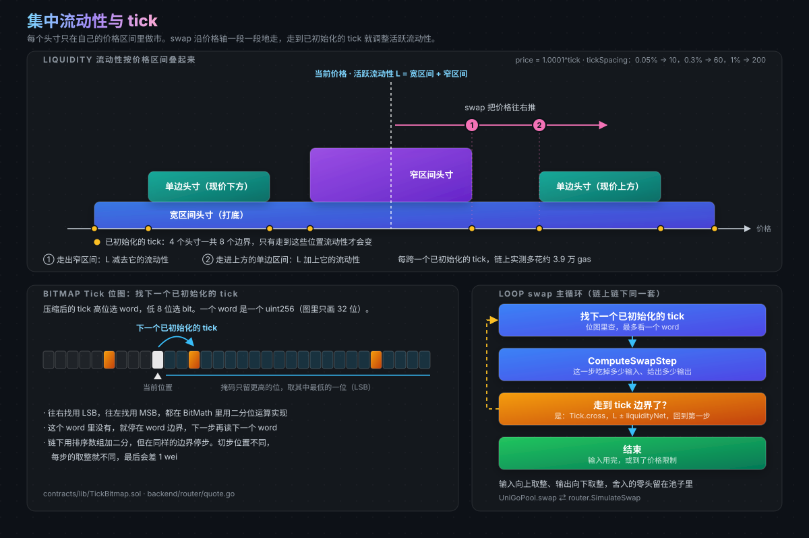
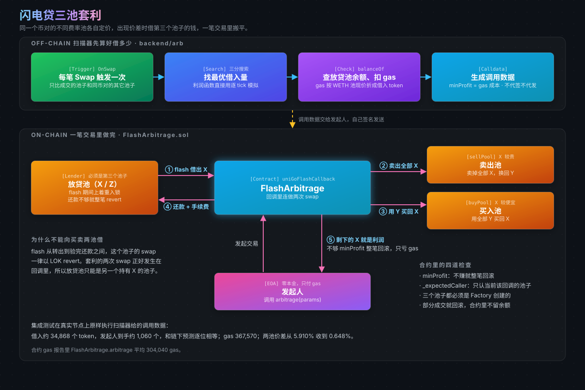
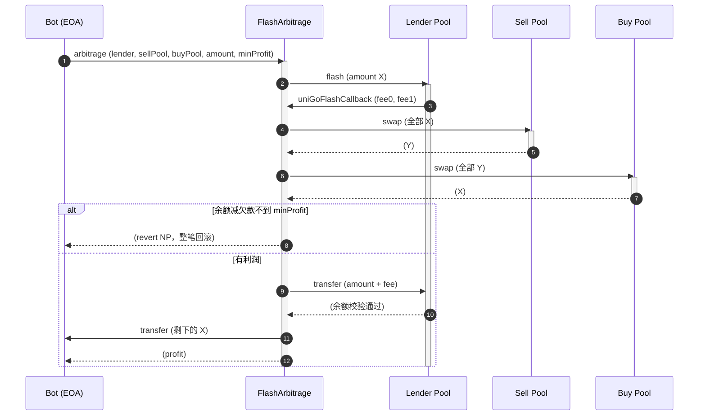
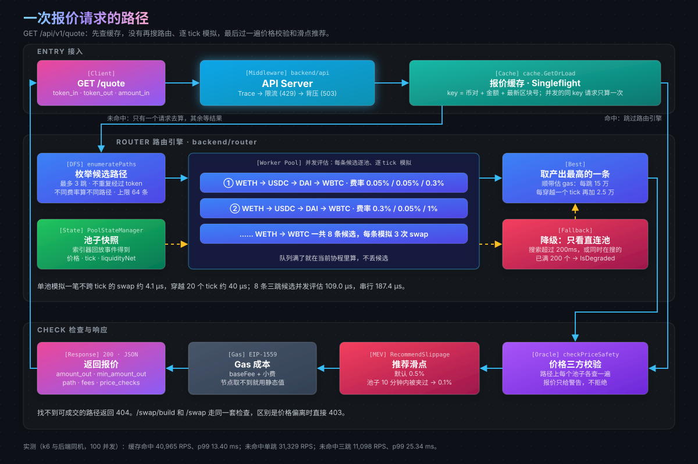
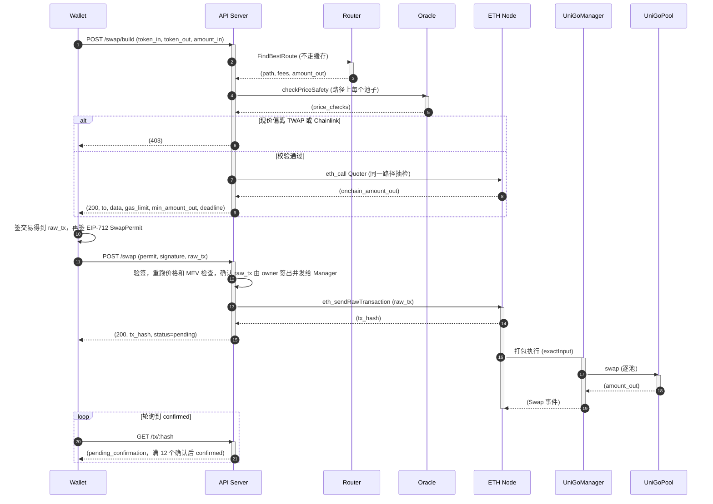
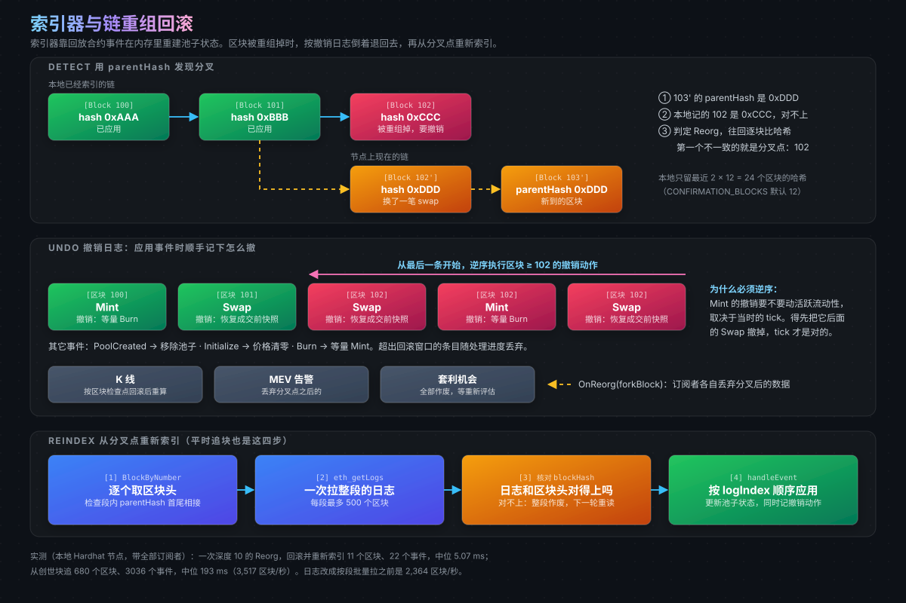
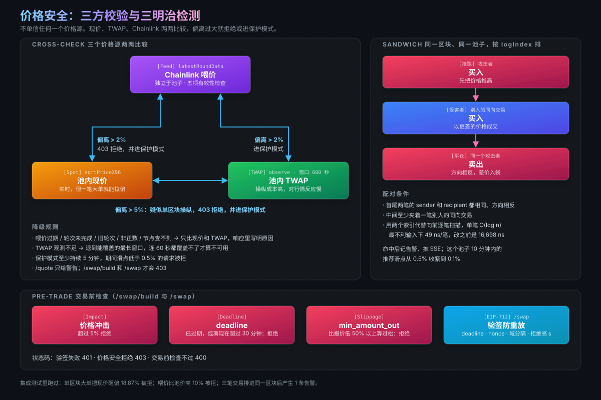
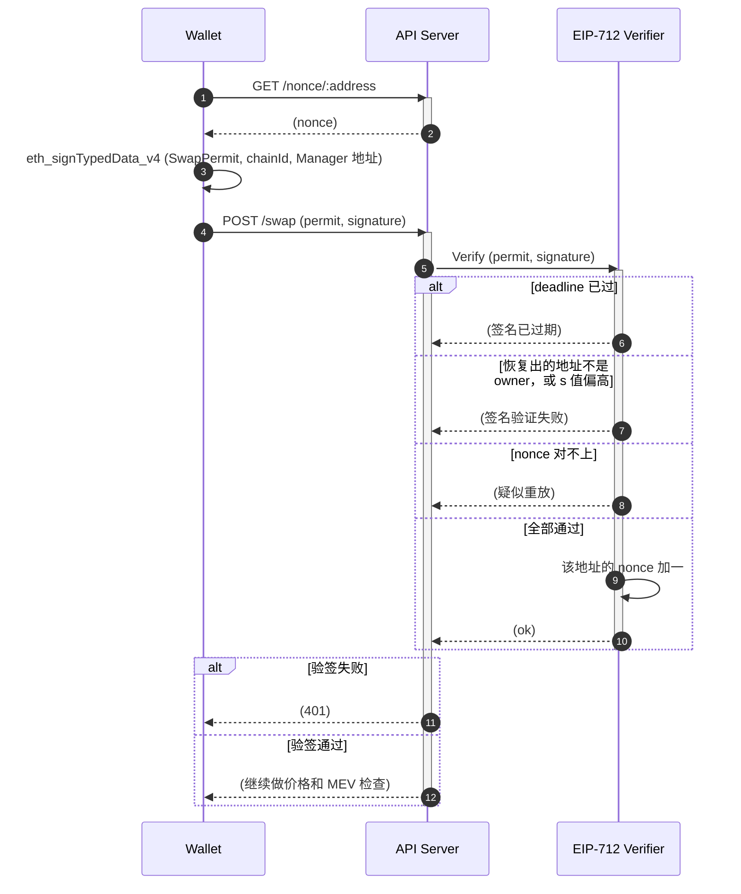
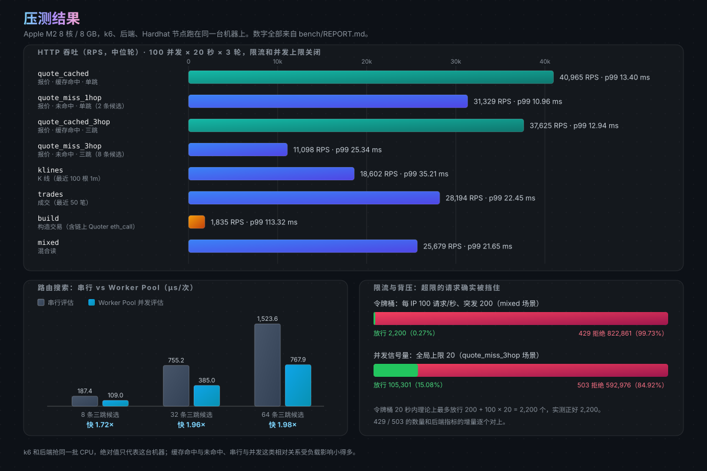

# UniGo-DEX

照着 Uniswap V3 的集中流动性机制，从数学库开始写的一套 DEX：Solidity 合约、Go 后端、The Graph 子图，再加上把它们接到同一个节点上跑的端到端测试和一套能复现的压测。

我做它是想弄明白三件事：AMM 的数学在链上到底怎么算；链下报价怎样才能和链上一个 wei 都不差；链会重组、节点会挂、价格会被人操纵的时候，后端该怎么办。所以没有调 SDK，`mulDiv`、`TickMath`、swap 主循环都是自己写的，Go 这边用 `math/big` 又照着写了一遍。

[整体架构](#整体架构) · [合约](#合约) · [后端](#后端) · [安全](#安全) · [压测](#压测) · [测试](#测试) · [快速开始](#快速开始) · [API](#api-一览) · [详细文档](#详细文档)

## 技术栈

| 层 | 用了什么 |
|---|---|
| 合约 | Solidity 0.8.20（optimizer + viaIR）、Hardhat、OpenZeppelin 的 IERC20 / SafeERC20 |
| 后端 | Go 1.24+，HTTP 用标准库 `net/http`，链交互用 go-ethereum v1.17.3 |
| 索引 | 后端内置事件索引器；The Graph 子图（AssemblyScript） |
| 数学 | Q64.96 定点数、512 位中间精度、`math/big` |
| 观测 | `slog` 结构化日志、Prometheus 文本格式指标、SSE 推送 |
| 签名 | EIP-712、secp256k1 签名恢复 |
| 测试与压测 | Hardhat + Chai、`go test`、自起节点的集成测试、k6 |

## 整体架构



图里有两条线。

请求从上往下走：API 先查缓存，没有就让路由在池子快照上逐 tick 模拟，过一遍价格和 MEV 检查，再把路由编码成 `UniGoManager` 的调用数据交给钱包签名。签好的交易由后端转发广播，之后按确认数查状态。后端不托管私钥。

事件从下往上走：合约事件经 `chain.Client` 解码，索引器把它们回放到 `PoolStateManager`，每笔 Swap 再分给 K 线、三明治检测、套利扫描和预言机，最后经 SSE 推给前端。子图索引的是同一批事件，用 GraphQL 查历史。

不配 `RPC_URL` 也能启动，这时索引器用内置的模拟源，只出空区块。

## 合约

### 集中流动性与 tick



- 价格存成 Q64.96 的 `sqrtPriceX96`。乘除走 512 位中间精度的 `mulDiv`，tick 和价格互转用 20 个预计算常数查表。
- 找下一个已初始化的 tick 靠位图，一次最多看一个 word。暴力遍历最坏要读上万次 `SLOAD`。
- 手续费按 `feeGrowthGlobal` 全局累计，每个 tick 记“外侧”累计值，跨 tick 时翻转，position 领取时做差。
- TWAP 用观测环形数组，查询时二分加线性插值。

五个合约各管一件事：

| 合约 | 做什么 |
|---|---|
| `UniGoPool` | mint / burn / collect / swap / flash，转账走回调加余额校验，带重入锁 |
| `UniGoFactory` | CREATE2 部署池子，salt 是 `keccak256(token0, token1, fee)`，三档费率 0.05% / 0.3% / 1% |
| `UniGoManager` | 用户入口：deadline、滑点、多跳 `exactInput`、`exactOutputSingle`，入口和回调都向 Factory 反查池子真伪 |
| `UniGoQuoter` | 真的执行一遍 swap，在回调里 revert 把结果带出来 |
| `FlashArbitrage` | 闪电贷加两次 swap 的套利合约 |

单笔交易的 gas（`contracts/test/Gas.test.js`，经 Manager 调用）：

| 场景 | gasUsed |
|---|--:|
| 单跳 swap，不跨 tick | 111,795 |
| 单跳 swap，跨 1 个已初始化 tick | 150,411 |
| 两跳 `exactInput` | 205,465 |
| mint 一个新区间 | 264,208 |
| flash，借 token0 | 75,798 |

跨一个 tick 多出来的 3.9 万 gas 花在 `Tick.cross` 上：翻转两个手续费累计值，改一次活跃流动性。

安全上补了两处。单个 tick 的流动性有上限（`uint128` 容量按 tick 数均分），挡住把 `liquidityNet` 加到回绕的攻击；转账全部走 SafeERC20，USDT 那种不返回值的代币和返回 `false` 的代币都有回归测试。

细节见 [docs/contracts.md](docs/contracts.md)，第 1 到 13 节。

### 闪电贷三池套利



同一个币对的 0.05% 池和 0.3% 池各自定价，一笔大单就能把它们推出价差。借多少最赚由后端算：利润对借入量是单峰的，用三分搜索找峰值，利润函数直接调逐 tick 模拟，所以链下算出的利润就是链上能拿到的数。

放贷池不能随便选。`flash` 期间池子上着重入锁，回调里再对它 `swap` 会 `LOK` revert，所以钱必须向第三个池子借。



## 后端

### 一次报价怎么算出来



- 缓存 key 里带最新区块号。池子状态只在出新块时变，所以同一个区块内直接命中，出了新块自动失效。
- 路由先用 DFS 枚举候选，再交给 Goroutine 池并发评估。评估是大数运算，64 条三跳候选串行要 1,523.6 µs，并发 767.9 µs。
- 搜索超过 200ms 或者并发搜索数到了上限，就退回只看直连池。行情最挤的时候宁可给一个次优报价，也不让请求排队。
- 链下模拟连“在哪里切步”都和链上一样。每一步输入向上取整、输出向下取整，同一笔 swap 切成 2 步和切成 3 步可能差 1 wei，所以链下虽然用排序数组，也在位图的 word 边界停步。

集成测试在真实节点上拿 60 条单跳和多跳报价和链上 Quoter 比，初始状态、几笔真实 swap 之后、全部场景跑完之后各比一轮，每轮 60 条全部逐位相等。

压测时发现过一个问题。缓存 key 里带着金额，每个请求换一个金额就是一个新 key，20 秒压下来后端常驻内存涨到 762.4 MB。加了条目数上限（默认 10000，按写入顺序淘汰）之后是 69.1 MB。

### 一笔兑换从构造到确认



构造交易时不走缓存，每次重新搜路由。配了 `QUOTER_ADDRESS` 就拿同一条路径问一次链上 Quoter，两边不一致时滑点保护按低的一方算。

### 索引器与 Reorg 回滚



- 只把“最后处理到的区块号”改回去是不够的。被回滚的 Mint 留下的流动性、被回滚的 Swap 推过的价格都还在，所以每应用一个事件就记一条撤销动作。
- 撤销必须倒着做，原因写在图里。
- 区块头和日志是分两步读的，中间链可能重组。每条日志的 `blockHash` 都要和刚拿到的区块头对一遍，对不上整段作废。
- 追块原来每个区块发一次 `eth_getLogs`。改成每 500 个区块一次，再把逐事件日志降到 debug，对本地节点从 2,364 区块/秒到 3,517 区块/秒。

其它模块的说明在 [docs/backend.md](docs/backend.md)（链下数学库、chain 包、缓存、Gas 评估）、[docs/market-mev.md](docs/market-mev.md)（K 线、套利扫描、SSE）和 [docs/infrastructure.md](docs/infrastructure.md)（断路器、Goroutine 池、日志、指标、限流、优雅关闭）。

## 安全

### 价格校验与三明治检测



- 三个价格源各有各的毛病：现价一笔大单就能拉偏，TWAP 和现价出自同一个池子，Chainlink 会过期。两两比较，一个出问题另外两个能发现。
- Chainlink 的 `latestRoundData()` 永远会返回一组数，能不能用要查五项：答案为正、轮次已完成、不是旧轮次、时间不晚于最新区块、没超过心跳。过期判断用链上最新区块的时间，不用本机时钟。
- 换算口径最容易错。喂价是按人类单位的“1 个 base 值多少 quote”，池子价格是没调 decimals 的 `token1 / token0`，哪个币是 token0 还得看地址大小。
- 喂价不可用时不拿坏数据硬比，降级成现价对 TWAP 两方，响应里写明原因。
- 本地部署和集成测试里的聚合器是一个可控的模拟合约 `TestAggregator`，实现的是 `AggregatorV3Interface`。接到别的网络时，把 `CHAINLINK_FEEDS` 换成那条链上的聚合器地址。

三明治检测一开始是每来一笔 swap 就向前逐笔配对。同一个地址在一个区块里来回买卖 256 笔时，单笔要 16,698 ns。改成按交易方和方向建索引之后是 49 ns，而且不随区块里的笔数增长。

### EIP-712 签名验证

提交交易前，钱包要对 `SwapPermit` 做一次类型化签名。后端查三样东西：deadline、nonce、域分隔符（链 ID 加 Manager 地址）。另外只接受低 s 值的签名，同一条消息不会有两种合法写法。



摘要的算法和 go-ethereum 的标准类型化数据实现对过，钱包用 `eth_signTypedData_v4` 签出来的能验过。

## 压测



环境是一台 Apple M2（8 核、8 GB）。k6、后端、Hardhat 节点都在这台机器上，k6 自己就要吃掉几个核，所以下面的吞吐是两边抢 CPU 的结果。完整数据、波动范围和修改前后的对比在 [bench/REPORT.md](bench/REPORT.md)，原始结果在 [bench/results/](bench/results/)。

HTTP 吞吐，100 并发 × 20 秒 × 3 轮，限流、并发上限、访问日志全关：

| 场景 | 说明 | RPS（中位轮） | p50 ms | p95 ms | p99 ms | 错误率 |
|---|---|--:|--:|--:|--:|--:|
| quote_cached | 报价，缓存命中，单跳 | 40,965 | 1.34 | 6.12 | 13.40 | 0.00% |
| quote_miss_1hop | 报价，缓存未命中，单跳 | 31,329 | 2.65 | 7.38 | 10.96 | 0.00% |
| quote_cached_3hop | 报价，缓存命中，三跳 | 37,625 | 1.60 | 6.81 | 12.94 | 0.00% |
| quote_miss_3hop | 报价，缓存未命中，三跳（8 条候选） | 11,098 | 8.04 | 18.72 | 25.34 | 0.00% |
| klines | K 线，最近 100 根 1m | 18,602 | 3.21 | 17.94 | 35.21 | 0.00% |
| trades | 成交，最近 50 笔 | 28,194 | 2.07 | 10.55 | 22.45 | 0.00% |
| build | 构造待签名交易 | 1,835 | 52.64 | 72.37 | 113.32 | 0.00% |
| mixed | 混合读 | 25,679 | 2.36 | 11.49 | 21.65 | 0.00% |

`build` 慢是因为每个请求都要对链上 Quoter 做一次 `eth_call`，吞吐由 Hardhat 节点决定。每轮跑完，压测脚本会拿后端的 `http_requests_total` 增量和 k6 发出的请求数对一遍，八个场景全部一致。

限流和背压打开之后：

| 后端配置 | 请求总数 | 放行（200） | 429 | 503 |
|---|--:|--:|--:|--:|
| 每 IP 100 请求/秒、突发 200，全局并发上限 500 | 825,061 | 2,200（0.27%） | 822,861（99.73%） | 0 |
| 限流关闭，全局并发上限 20 | 698,277 | 105,301（15.08%） | 0 | 592,976（84.92%） |

其它几项：

| 测了什么 | 结果 |
|---|---|
| SSE，500 个订阅端、60 笔成交 | 送达 30,000 次，未送达 0；端到端 p50 90.56 ms、p99 198.33 ms；扇出 p50 1.71 ms |
| SSE，200 个正常订阅端加 5 个只连不读的 | 1,200,000 / 1,200,000 送达；5 个慢客户端被断开，正常订阅端 200 / 200 收全 |
| 逐 tick 模拟一笔 swap | 不跨 tick 4,106 ns；穿越 20 个 tick 40,210 ns |
| 索引器回放（内存数据源，不含 RPC） | 只有索引器 1,508,725 事件/秒；带 K 线、三明治检测、预言机 451,534 事件/秒 |
| 对本地节点追块 | 680 个区块、3036 个事件，中位 193 ms，3,517 区块/秒 |
| 一次深度 10 的 Reorg | 回滚并重新索引 11 个区块、22 个事件，中位 5.07 ms |

SSE 的端到端延迟里含索引器的轮询等待，压测时轮询间隔设的是 200 毫秒。

复现：`bench/run-all.sh`，大约 25 分钟，需要 Go、Node.js 和 k6。分步的跑法见 [docs/benchmark.md](docs/benchmark.md)。

## 测试

| 层 | 规模 | 怎么跑 |
|---|---|---|
| 合约 | 109 个用例，9 个文件 | `cd contracts && npx hardhat test` |
| Go 单元测试 | 16 个包，101 个测试函数 | `cd backend && go test -p 2 ./...` |
| 端到端 | 12 个场景，测试自己拉起 Hardhat 节点 | `cd backend && go test -p 2 -tags integration -count=1 -timeout 15m ./integration` |

有两处比较花心思。

`Invariants.test.js` 用固定种子对一个池子连做 300 步随机操作，里面混了在极端区间 mint 接近 `int128` 上限流动性的攻击性操作。每一步之后都查四条不变量：池子付得出所有 position 的本金和手续费、活跃流动性等于覆盖现价的 position 之和、`feeGrowthGlobal` 不减、每个 tick 的记账和 position 对得上。种子固定，失败了能稳定复现。

端到端测试按 `main.go` 的方式把后端各模块接到真实节点上，12 个场景在同一条链上顺序跑：报价和链上 Quoter 逐位比对、多跳交易签名广播到确认、TWAP 读数和手算一致、现价被砸偏后拒绝交易、把三笔交易排进同一个区块触发三明治告警、零本金账户原样执行套利调用数据、用 `evm_snapshot` / `evm_revert` 制造 Reorg、Chainlink 喂价的各种坏数据。

每个文件和每个场景的说明见 [docs/testing.md](docs/testing.md)。

## 测试网部署

<!-- TESTNET -->

## 快速开始

需要 Node.js 18 以上和 Go 1.24 以上。

```bash
git clone <repo-url> && cd UniGo-DEX

# 合约
cd contracts && npm install
npx hardhat compile
npx hardhat test

# 后端
cd ../backend
go build ./...
go test -p 2 ./...
```

在本地跑一套能直接交易的环境，开三个终端：

```bash
# 终端 1：本地节点，http://127.0.0.1:8545，chainId 31337
cd contracts && npx hardhat node

# 终端 2：部署合约、4 个测试代币、6 个池子并注入流动性
cd contracts && npx hardhat run scripts/deploy.js --network localhost

# 终端 3：部署脚本最后会打印一条带全部环境变量的启动命令，复制到 backend/ 下执行
cd backend && RPC_URL=http://127.0.0.1:8545 FACTORY_ADDRESS=0x... go run .
```

起来之后试一下：

```bash
curl localhost:8080/api/v1/pools
curl "localhost:8080/api/v1/quote?token_in=<WETH>&token_out=<USDC>&amount_in=1000000000000000000"
curl -N localhost:8080/api/v1/stream
```

在全新的节点上，1 WETH 的报价是 `1998996425874440730518`，和部署脚本里链上 Quoter 自检打印的 `1998.996425874440730518 USDC` 是同一个数。

子图在 `subgraph/` 下，`npm run abis && npm run codegen && npm run build` 编译成 WASM，部署到自己的 graph-node 上查询。

全部环境变量、Makefile 命令和部署脚本的输出见 [docs/getting-started.md](docs/getting-started.md)。

## API 一览

数量一律用十进制字符串传。每个响应都带 `X-Trace-Id`。

| 方法 | 路径 | 说明 |
|---|---|---|
| GET | `/api/v1/quote` | 报价：最优路径、产出、价格冲击、推荐滑点、Gas 成本、价格校验明细。没有可成交的路径返回 404 |
| POST | `/api/v1/swap/build` | 把路由编码成 Manager 的调用数据，返回待签名交易。价格偏离时 403 |
| POST | `/api/v1/swap` | EIP-712 验签加价格和 MEV 检查，带 `raw_tx` 时广播 |
| GET | `/api/v1/nonce/{address}` | EIP-712 签名用的 nonce |
| GET | `/api/v1/tx/{hash}` | 交易状态：`pending` / `pending_confirmation` / `confirmed` / `reverted` |
| GET | `/api/v1/pools` | 所有池子的价格、tick、活跃流动性 |
| GET | `/api/v1/klines` | K 线，周期 `1m` `5m` `15m` `1h` `4h` `1d` |
| GET | `/api/v1/trades` | 最近成交 |
| GET | `/api/v1/twap` | 单个池子的价格校验明细 |
| GET | `/api/v1/mev/alerts` | 三明治告警 |
| GET | `/api/v1/arbitrage/opportunities` | 当前套利机会和调用数据 |
| GET | `/api/v1/stream` | SSE 推送：`trade` `kline` `mev_alert` `arbitrage` |
| GET | `/api/v1/status` | 索引进度、Reorg 次数、路由统计、保护模式中的交易对 |
| GET | `/metrics` | Prometheus 文本格式指标 |
| GET | `/health` | 健康检查 |

参数和状态码见 [docs/getting-started.md](docs/getting-started.md#api-端点)。

## 项目结构

```
UniGo-DEX/
├── contracts/               Solidity 合约（Hardhat）
│   ├── contracts/           5 个核心合约、lib/ 下 11 个库、test/ 下的测试辅助合约
│   ├── test/                109 个用例
│   └── scripts/deploy.js    部署全套合约、代币、池子并注入流动性
├── backend/                 Go 后端
│   ├── api/                 HTTP 路由、中间件、交易构造
│   ├── router/              逐 tick 模拟和路由搜索
│   ├── indexer/             事件索引、Reorg 回滚、池子状态
│   ├── chain/               go-ethereum 封装和内嵌 ABI
│   ├── oracle/              现价 / TWAP / Chainlink 校验
│   ├── mev/  arb/  kline/   三明治检测、套利扫描、K 线
│   ├── math/                和链上逐位一致的数学库
│   ├── cache/  eip712/  gas/  ws/
│   ├── circuitbreaker/  workerpool/  logging/  metrics/
│   ├── integration/         端到端测试
│   └── cmd/bench/           追块和 SSE 压测工具
├── subgraph/                The Graph 子图
├── bench/                   k6 脚本、压测脚本、原始结果、REPORT.md
└── docs/                    详细文档和图
```

带注释的完整目录树在 [docs/project-structure.md](docs/project-structure.md)。

## 详细文档

| 文档 | 内容 |
|---|---|
| [docs/highlights.md](docs/highlights.md) | 所有技术点的一览表，带代码位置 |
| [docs/contracts.md](docs/contracts.md) | 第 1 到 13 节：数学模型、Q64.96、位图、回调、CREATE2、Quoter、手续费、闪电贷、Manager、TWAP、套利合约、安全加固、子图 |
| [docs/backend.md](docs/backend.md) | 第 14 到 22 节：链下数学库、chain 包、索引器、路由、缓存、价格安全、交易构造、EIP-712、Gas |
| [docs/market-mev.md](docs/market-mev.md) | 第 23 到 26 节：K 线、三明治检测、套利扫描、SSE |
| [docs/infrastructure.md](docs/infrastructure.md) | 第 27 到 32 节：断路器、Goroutine 池、日志、指标、限流与背压、优雅关闭 |
| [docs/testing.md](docs/testing.md) | 三层测试的明细 |
| [docs/benchmark.md](docs/benchmark.md) | Gas 基准、Goroutine 池基准、压测的精选结果和复现步骤 |
| [docs/getting-started.md](docs/getting-started.md) | 部署步骤、环境变量、API 端点 |

## 参考资料

- [Uniswap V3 白皮书](https://uniswap.org/whitepaper-v3.pdf)
- [Uniswap V3 开发教程](https://uniswapv3book.com/)
- [Uniswap V3 Core 源码](https://github.com/Uniswap/v3-core)
- [EIP-712](https://eips.ethereum.org/EIPS/eip-712) 和 [EIP-1559](https://eips.ethereum.org/EIPS/eip-1559)
- [go-ethereum 文档](https://geth.ethereum.org/docs)
- [The Graph 文档](https://thegraph.com/docs/)
- [Chainlink Price Feeds](https://docs.chain.link/data-feeds)
- [k6 文档](https://grafana.com/docs/k6/latest/)

## 许可证

GPL-2.0-or-later
